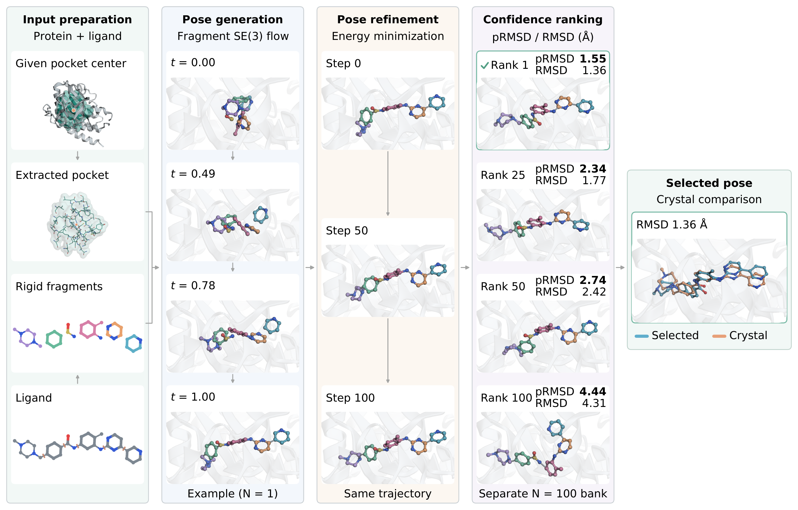
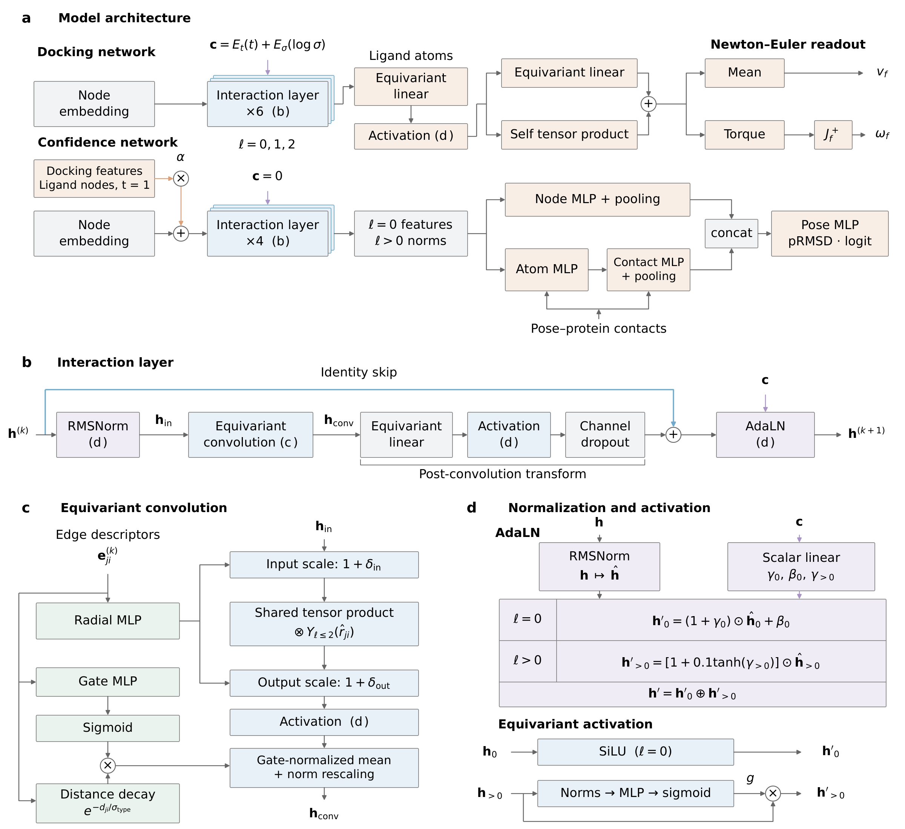

# EFF-Dock

**Fragment-based docking in a supplied protein pocket.**

EFF-Dock predicts protein–ligand poses in a supplied binding pocket with a
fragment-based SE(3) flow model and a paired pose-confidence model. This
repository provides runnable code, two pretrained checkpoints and method
illustrations.

[Install](#install) · [Dock a ligand](#dock-a-ligand) ·
[Python API](#python-api) · [Architecture](#architecture) ·
[Documentation](#code-and-model-documentation)

[](docs/assets/workflow.png)

The study workflow combines fragment pose generation, energy-based
post-refinement and confidence ranking. The quick-start command below
generates and ranks poses; post-refinement and chirality-aware reselection
are separate workflows. Crystal RMSDs shown in the example are retrospective
annotations, not ranking inputs. Click either figure for the full-size image.

## Install

The supported environment is Linux, Python 3.12 and an NVIDIA GPU/driver
compatible with CUDA 13.0. Install [uv](https://docs.astral.sh/uv/) and
[Git LFS](https://git-lfs.com/) first. The Python version and dependencies are
pinned in `.python-version` and `uv.lock`.

```bash
git lfs install
git clone https://github.com/eightmm/EFF-Dock.git
cd EFF-Dock
git lfs pull
uv sync --frozen --python 3.12
uv run python scripts/verify_release.py
```

The LFS download contains approximately 100 MB of model files. If cloning was
done with LFS downloads disabled, `git lfs pull` replaces the pointer files
with the checkpoints. The verifier checks their SHA-256 hashes and loads both
models on CPU. No dataset, API key or experiment-tracking login is needed for
inference.

## Dock a ligand

Run from the repository root. Supply a prepared receptor PDB, a ligand SDF or
SMILES string, and a pocket center in the receptor's coordinate frame:

```bash
uv run eff-dock dock \
  --protein receptor.pdb \
  --ligand ligand.sdf \
  --pocket-center '12.4,-3.1,8.7' \
  --orientation-injection rw \
  --confidence-frame-policy contextual_v1 \
  --rank-by confidence \
  --no-score \
  --device cuda \
  --seed 42 \
  --output-dir outputs/docked
```

Replace the input filenames and example center with your own. For SMILES, use
an argument such as `--ligand 'CCO'`. The default budget is 100 poses, 10
late-biased ODE steps, a 2 Å translation prior and a 10 Å receptor crop. The
explicit convention options above select the evaluated `rw` and
`contextual_v1` paths; checkpoint-compatible historical defaults remain
available as documented in [coordinate conventions](docs/ORIENTATION_INJECTION.md).

The command generates poses and ranks them by the confidence model's predicted
RMSD. `--no-score` disables the optional Vina/DG scoring, while confidence
scoring remains active. Outputs are `docked_poses.sdf` (best-ranked pose first)
and `results.pt`; a single-pose run writes `docked.sdf` instead. This command
does not automatically apply energy refinement or chirality-filtered reselection; those are separate workflows.
It requires a known pocket and does not predict binding affinity.

For a small installation check using a synthetic receptor and one pose:

```bash
uv run python scripts/verify_release.py --smoke
```

This check requires an available CUDA GPU and exercises preparation, sampling,
confidence scoring and SDF export with the released checkpoints. It is not an
accuracy benchmark; the command without `--smoke` only loads the models on CPU.

## Python API

```python
from pathlib import Path
import torch
from effdock.inference import DockingOptions, dock

dock(DockingOptions(
    protein=Path("receptor.pdb"),
    ligand="ligand.sdf",
    pocket_center=torch.tensor([12.4, -3.1, 8.7]),
    orientation_injection="rw",
    confidence_frame_policy="contextual_v1",
    rank_by="confidence",
    score=False,
    device="cuda",
    seed=42,
    out_dir=Path("outputs/docked"),
))
```

## Architecture

[](docs/assets/architecture.png)

The docking network predicts fragment translation and rotation through a
Newton–Euler readout. The confidence network combines atom and protein–ligand
contact features to predict pose RMSD for ranking. The figure expands the
shared interaction layers, equivariant convolution, normalization and activation.
See the [model contract](docs/MODEL.md) and
[implementation details](docs/methods/README.md) for the released checkpoints
and coordinate conventions.

## Evaluation scope

EFF-Dock performs supplied-pocket docking. The released checkpoints use a
historical training split; its overlap exclusions do not establish complete
ligand-and-pocket disjointness from every external benchmark. See
[data preparation](docs/DATA.md),
[training membership and overlap definitions](benchmarks/inputs/training_membership/README.md)
and the [evaluation protocol](docs/EVALUATION.md) when interpreting or
reproducing benchmark results.

## Code and model documentation

- [`weights/MANIFEST.md`](weights/MANIFEST.md): checkpoints, hashes and model cards.
- [`docs/README.md`](docs/README.md): data preparation, architecture, training and evaluation.
- [`docs/REPRODUCIBILITY.md`](docs/REPRODUCIBILITY.md): environment and checkpoint contracts.
- [`scripts/README.md`](scripts/README.md): retained workflow and verification helpers.
- [`benchmarks/README.md`](benchmarks/README.md): optional external-model adapters.
- [`docs/assets/README.md`](docs/assets/README.md): illustration sources and scope.

Manuscripts, full figure bundles, saved study results and local run logs are
kept separately from this code release.

Training and evaluation require separately prepared data. They are exposed
through `eff-dock data`, `eff-dock train`, `eff-dock confidence` and
`eff-dock evaluate`; run each command with `--help` for its options.

For development checks:

```bash
uv sync --frozen --python 3.12 --group dev
uv run pytest -q -m 'not gpu'
bash scripts/check.sh fast
```

## License

Source code and the two released EFF-Dock checkpoints are provided under
[Apache License 2.0](LICENSE). Third-party software and datasets retain their
own terms.
